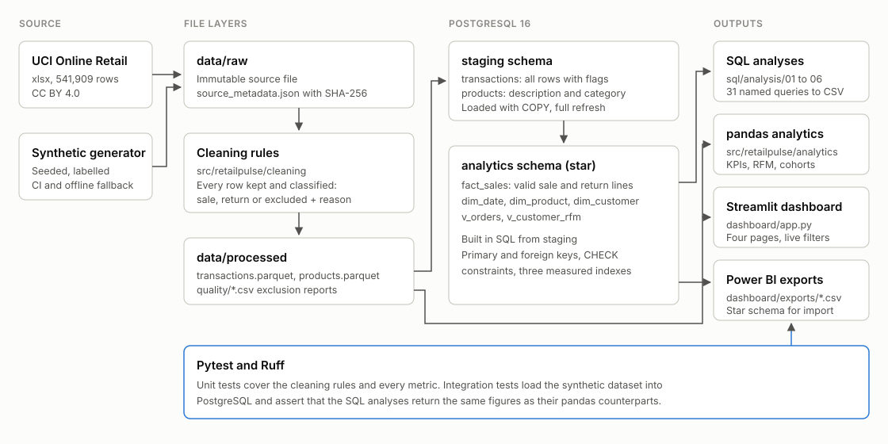
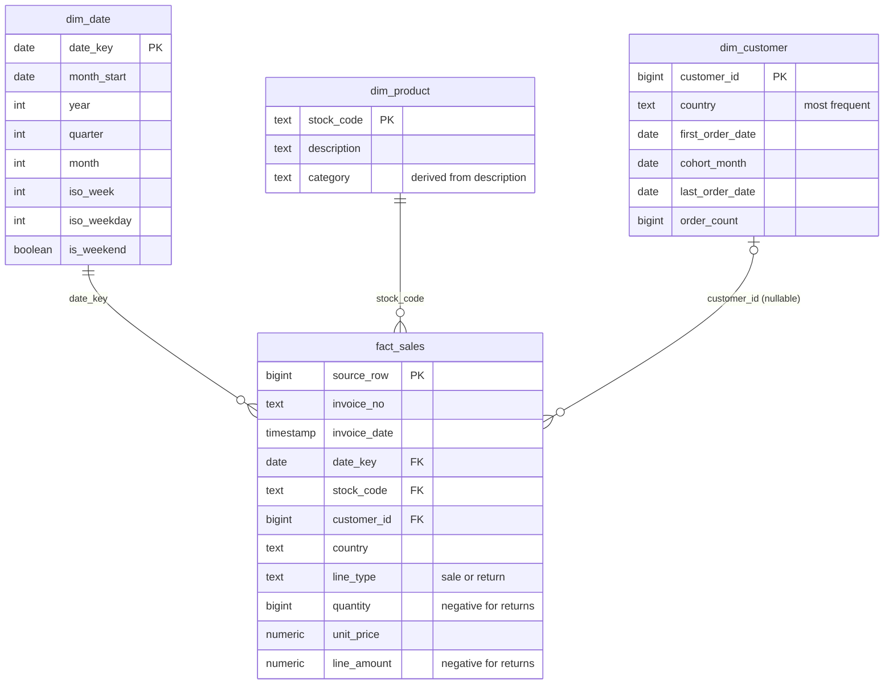

# Architecture

## Layers

| Layer | Location | Contents | Rule |
|---|---|---|---|
| Raw | `data/raw/` | Source file exactly as downloaded, plus `source_metadata.json` (URL, licence, SHA-256, retrieval time) | Never modified. `retailpulse ingest` refuses to overwrite it without `--force`. |
| Processed | `data/processed/` | `transactions.parquet` (every source row, typed and classified), `products.parquet`, `quality/*.csv` | Rebuilt from raw on every run. |
| Staging | PostgreSQL `staging` | `transactions`, `products` | A typed copy of the processed layer. Keeps excluded rows so they can be audited in SQL. |
| Analytics | PostgreSQL `analytics` | `fact_sales`, `dim_date`, `dim_product`, `dim_customer`, views `v_orders`, `v_customer_rfm` | Built in SQL from staging. Contains valid sale and return lines only. |
| Outputs | `data/processed/sql_results/`, `data/processed/analytics/`, `dashboard/exports/` | One CSV per SQL query, pandas analytics tables, star schema CSVs for Power BI | Generated, not committed. |

## Modules

| Module | Responsibility |
|---|---|
| `retailpulse.ingestion` | Download the UCI archive, record provenance, read raw files without interpreting values, generate the synthetic fallback. |
| `retailpulse.cleaning` | Type conversion, classification rules, duplicate detection, product catalogue with derived category, data-quality reports. |
| `retailpulse.analytics` | Pure pandas functions for every metric. They take a classified transactions frame and return a table. |
| `retailpulse.database` | Engine creation, `COPY`-based loading, the named-query SQL runner and the star schema export. |
| `retailpulse.pipeline`, `retailpulse.cli` | Step orchestration and the `retailpulse` command. |
| `dashboard/` | Streamlit app. It calls the same `retailpulse.analytics` functions on filtered data, so the dashboard cannot drift from the tested metric logic. |

## Star schema

The grain of `fact_sales` is one invoice line. `source_row` is the row number in the source file, which makes every fact row traceable back to raw data. `customer_id` is nullable because 25% of sale lines carry no customer; those lines count towards revenue but not towards customer-level analyses.

`country` stays on the fact table as well as on `dim_customer`. Eight customers appear under more than one country, so the invoice-level country is the accurate attribute for geographic revenue, while `dim_customer.country` holds each customer's most frequent country.

## Design decisions

**Every row is classified, none is deleted.** The cleaning step adds `line_type` and `exclusion_reason` instead of filtering. The cost is a slightly larger staging table; the benefit is that every exclusion can be counted, valued and challenged (see [data_quality.md](data_quality.md)).

**Metrics are implemented twice on purpose.** SQL is the system of record for the warehouse, and pandas is what the dashboard and unit tests use. The integration tests assert that both return the same figures. On the real dataset this comparison caught a reconciliation bug in which products that were returned but never sold in the period were dropped from the product table.

**Full refresh rather than incremental load.** The source is a fixed historical extract. Rebuilding the tables in about 20 seconds is simpler and removes a class of state bugs. An incremental design would be needed for a live feed.

**Tie-safe RFM scoring.** `NTILE(5)` splits tied values across buckets arbitrarily, and a third of customers are tied on a frequency of one order. Scores are instead derived from the share of customers ranked strictly below, so equal values always share a score.

**Plain SQL files rather than a transformation framework.** Thirty-one queries over one fact table do not need dbt. The files are organised by topic, each query has a name, and a small runner executes them. The structure would map directly onto dbt models if the project grew.

**Synthetic data is a labelled fallback, not a substitute.** CI and offline runs use a seeded generator. `source_metadata.json` records `is_synthetic`, and the dashboard shows a warning banner when it is set.
